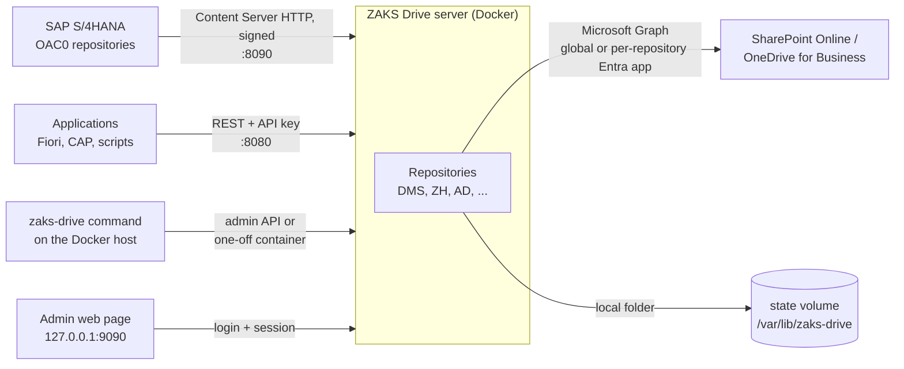
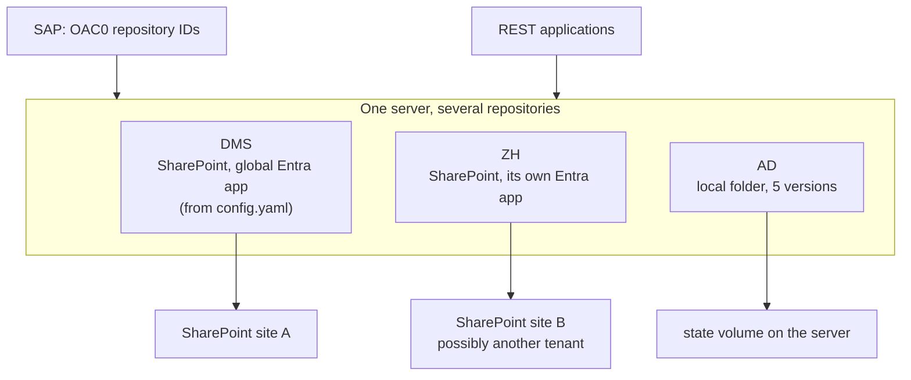
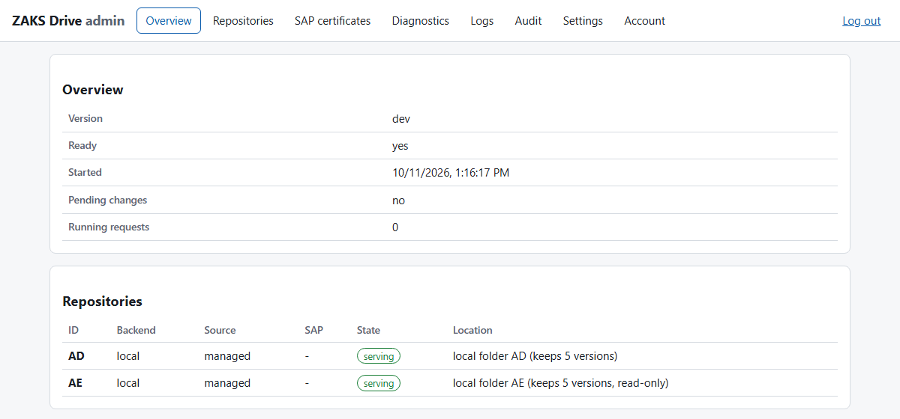
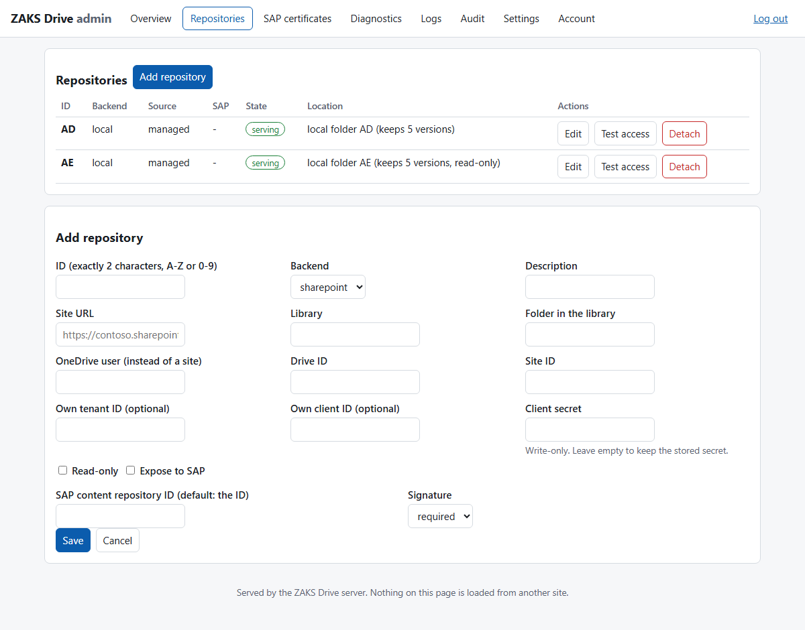

# ZAKS Drive

**Open-Source Enterprise Content Gateway**

Connect SAP S/4HANA and enterprise applications to Microsoft SharePoint Online, OneDrive for Business, or a folder on your own server.

ZAKS Drive is a lightweight, self-hosted content gateway. It gives SAP an SAP-compatible Content Server interface and gives your applications a REST API, and it stores the documents in **SharePoint / OneDrive** (through Microsoft Graph) or in a **local folder**. You can run **several repositories** side by side, each with its own storage type, and manage them from a command-line tool or a small admin web page. Documents in SharePoint stay under the Microsoft 365 security, retention and backup you already run.

[](https://github.com/Lamiv/zaks-drive/actions/workflows/ci.yml)
[](https://github.com/Lamiv/zaks-drive/releases)
[](LICENSE)
[](go.mod)

> **Status: pre-release.** The SAP protocol layer is tested against SAP's standard reports and a real SharePoint tenant, and a DMS original has been stored and retrieved end to end. Repositories, the local backend and the admin page are tested automatically and end to end in Docker, but have not been run against a real SAP system or a second Microsoft tenant, and the admin page awaits an independent security review. GOS and ArchiveLink are not yet tested. Read [what is verified](#what-is-verified) before relying on it.

## What it is

One small Go service in a Docker container, with two independent interfaces (use either or both):

- **SAP Content Server HTTP interface** for SAP DMS, KPro and applicable attachment scenarios (OAC0 content repositories).
- **REST API** for Fiori applications, CAP services, scripts and other enterprise applications.

Behind them sit **repositories**: named places for documents. A repository stores its documents in **SharePoint / OneDrive** or in a **local folder**, chosen once when it is created. There is no database to run.

ZAKS Drive is a content storage gateway, not a document management application: it has no document browser, workflow or business metadata of its own. Its admin page manages the gateway, not the documents.



Details: [architecture](docs/architecture.md).

## Why it exists

- SAP can store documents in an HTTP content server, but SharePoint does not speak that protocol.
- Microsoft Graph is powerful but has limits (paths, folder sizes, throttling, upload sessions) that every integration must handle again.
- Not every archive belongs in Microsoft 365: sometimes a folder on your own disk is the right place, with the same interfaces in front of it.
- ZAKS Drive does that once: it implements SAP's protocol, respects SharePoint's limits, offers both storage types behind one interface, and gives every failure a code with the cause and the fix.

## Features

**Interfaces**

- **SAP Content Server HTTP 4.5** (pVersion 0045 to 0047): create, read, update, append, delete, search, multi-document create, certificate exchange, signed URLs (DSA, RSA, ECDSA).
- **REST API** with uploads (large files via upload sessions), downloads with ranges, folders, versions, thumbnails (SharePoint), search, paging, ETags. Contract: [openapi.yaml](docs/api/openapi.yaml).

**Storage and repositories**

- **Two storage types.** **SharePoint / OneDrive**: sharded folders for SAP documents, name and path limit handling, version history, recycle-bin recovery. **Local folder**: confined to its own folder, links ignored, atomic writes, ETags that always change, up to 99 kept versions per file.
- **Several repositories** on one server (`Z1`, `ZH`, `AD`, ...), each exposed to REST applications and, if you choose, to SAP under the same ID.
- **A different Microsoft application per repository.** Each SharePoint repository uses the global Entra application or its own tenant, client and secret, with its own Graph client so a throttled tenant does not slow another.
- **Safe changes.** A change is validated by the server's own loader before it is saved, applied by a restart that first drains running requests (SAP retries those), and falls back to the last working state if something is wrong.

**Administration**

- **`zaks-drive` command** (on the Docker host): `setup`, `start`, `stop`, `restart`, `status`, `logs`, `doctor` (22 diagnostics), `check`, `repo` (list, show, add, update, remove, check, purge), `admin reset-password`, `update` and `rollback` with verified downloads, and a sanitized `support bundle`. Every flag is in the [CLI reference](docs/cli-reference.md).
- **Admin web page** on `127.0.0.1`: overview, repositories (add, edit, test access, detach), SAP certificates (compare fingerprint, activate), diagnostics, logs, audit, settings, and one-click apply. See [the admin UI guide](docs/ui.md).
- **Admin API** behind both, with coded errors, for scripts.

**Security**

- **Authentication:** API keys with per-key permissions and repositories, optional JWT; SAP signature verification with certificate activation.
- **Admin page login:** user `admin`; the well-known first password `admin` only opens a screen to choose a new one (at least 12 characters), stored as a salted Argon2id hash. Session cookie `HttpOnly`/`SameSite=Strict`, CSRF and Origin checks, lockout that doubles on repeats, strict CSP, nothing loaded from other sites.
- **Secrets** never appear in flags, output, logs, bundles or definitions; a repository's own secret is a separate file (mode 600). Every change is recorded in an audit log.
- **Deliberately hard to destroy data:** purging a local repository exists only on the Docker host, needs a plan, a time-limited challenge bound to the folder, the typed ID and an explicit flag, and is not in the admin API or the page.
- **Verified installer:** downloads are checked against `SHA256SUMS` (and optionally GitHub build attestation) before anything runs; no `sudo`, no Docker installation.

**Operability**

- Health and readiness endpoints (ready only when every repository is reachable), Prometheus metrics, JSON logs with request IDs, an access checklist, and [error codes](docs/error-codes.md) with cause and fix.
- **Small and constrained:** static binary, distroless non-root image, read-only root filesystem, bounded memory.

## Repositories



- **Each repository has exactly one storage type**, set when it is created. It cannot be switched later, because documents are not moved between the two.
- **Managed repositories** (created with `zaks-drive repo` or the admin page) have a 2-character ID (A-Z, 0-9), the length of an SAP content repository ID. **Static repositories** written in `config.yaml` keep working unchanged.
- You can **start with a local folder and no Microsoft account at all**, and add SharePoint later, or the other way round.

```bash
zaks-drive repo add AD --backend local --sap --yes                       # a folder on this server, exposed to SAP as AD
zaks-drive repo add ZH --backend sharepoint --site-url https://contoso.sharepoint.com/sites/HR \
    --tenant-id <guid> --client-id <guid> --secret-file ./zh-secret --yes # its own Microsoft application
zaks-drive repo list
```

## The admin page

A small page served by the server itself (no extra service, nothing loaded from other sites). It is bound to `127.0.0.1`: reach it through an SSH tunnel or a reverse proxy you operate.





## Use cases

| You want to... | Use |
|---|---|
| Keep SAP DMS, GOS or ArchiveLink documents in SharePoint instead of a dedicated content server | The SAP Content Server interface (DMS originals [verified end to end](#what-is-verified); GOS and ArchiveLink not yet tested) |
| Keep an SAP archive on your own disk, with the same SAP interface | A local repository exposed to SAP |
| Let a Fiori app, a CAP service or a script store and fetch files without writing Graph code | The REST API |
| Serve several SAP content repositories, some in SharePoint (possibly other tenants) and some local | One server, several repositories |
| Give auditors and users the usual Microsoft 365 tools (search, retention, versions, recycle bin) over SAP documents | SharePoint repositories; ZAKS Drive is the bridge |
| Try it with nothing but Docker | The [quickstart](#quickstart) or a [local-first setup](#install-for-real-linux) |

## Requirements

- A Linux host with Docker Engine and Compose v2 (2 vCPU and 2 GB RAM is a reasonable start; the container is limited to 1 GB).
- **For SharePoint repositories:** a Microsoft 365 tenant with SharePoint Online or OneDrive for Business, and an administrator who can register an Entra application and grant admin consent. **Not needed for local repositories.**
- For SAP: an S/4HANA system (the protocol layer was tested on S/4HANA 2025), SAP Basis access to OAC0 and STRUST, and network access from SAP to port 8090.
- Go 1.26 or newer only if you build outside Docker.

## Quickstart

No Microsoft 365 tenant or SAP system needed; this uses a bundled Graph emulator.

```bash
git clone https://github.com/Lamiv/zaks-drive.git zaks-drive && cd zaks-drive
docker compose -f loadtest/docker-compose.yml up -d --build graphmock adapter

curl -sS -H "X-API-Key: loadtest-key" http://localhost:8080/api/v1/repositories
echo "hello" | curl -sS -X POST -H "X-API-Key: loadtest-key" --data-binary @- \
  "http://localhost:8080/api/v1/repositories/DMS/documents?folder=demo&fileName=hello.txt"
curl -sS 'http://localhost:8090/ContentServer/ContentServer.dll?serverInfo&pVersion=0047'
```

More: [quickstart](docs/quickstart.md).

## Install for real (Linux)

Install the command from a [release](https://github.com/Lamiv/zaks-drive/releases) (until one is published for your needs, build from source below), then pick a path.

```bash
curl -fsSLO https://github.com/Lamiv/zaks-drive/releases/download/v<version>/install.sh
less install.sh                          # read it first
sh install.sh --version <version>        # verifies the SHA-256 checksum before anything runs; no sudo, no Docker install
```

**Path A: local folder first, no Microsoft account**

```bash
zaks-drive setup --storage local         # or just: zaks-drive setup  (answer "local")
zaks-drive start                         # running; "no repository yet" is expected
zaks-drive repo add AD --backend local --yes
zaks-drive doctor                        # open the admin page, choose your password, add SharePoint later if you like
```

**Path B: SharePoint first**

```bash
zaks-drive setup                         # tenant, client, secret (hidden), SharePoint site, SAP repositories
zaks-drive start                         # waits until it is ready
zaks-drive check                         # tests SharePoint access (contacts Microsoft)
zaks-drive doctor
```

Prerequisites for path B: a [Microsoft Entra app](docs/microsoft-365/entra-app-registration.md) with [access to one SharePoint site](docs/microsoft-365/graph-permissions.md).

**Then open the admin page** at `http://127.0.0.1:9090/admin/ui/` and log in as `admin` with the password `admin`; it immediately asks you to choose your own. Do this right after the first start.

Day to day: `zaks-drive status | logs | repo | restart | update | rollback | support bundle`. The step-by-step [setup and usage guide](docs/guide.md) covers install, first start and 16 scenarios (SAP, several repositories, the admin page, backup, updates, a forgotten password, troubleshooting); every flag is in the [CLI reference](docs/cli-reference.md); the reasoning is in the [command guide](docs/cli.md).

<details>
<summary>From a source checkout, without the command</summary>

1. Copy `deploy/.env.example` to `deploy/.env` and `deploy/config.example.yaml` to `deploy/config.yaml`; set the tenant, client, secret and SharePoint location.
2. Start and verify:

```bash
docker compose -f deploy/docker-compose.yml up -d --build
docker compose -f deploy/docker-compose.yml exec adapter /zaks-drive-server check
```

To build the command itself: `go build -o zaks-drive ./cmd/zaks-drive`.

</details>

Full guide: [installation](docs/installation.md), [configuration reference](docs/configuration.md).

## Connect SAP S/4HANA

Enable the `contentrepo` interface, create the repository in OAC0 with the same ID as the ZAKS Drive repository (storage type 04, version 0047), send SAP's certificate, compare its fingerprint with STRUST and activate it (admin page, *SAP certificates*), and run SAP's `RSCMST` reports. Step by step: [Connect SAP S/4HANA to SharePoint using ZAKS Drive](docs/sap/connect-s4hana-to-sharepoint.md) and [guide, scenario 3](docs/guide.md#scenario-3-connect-sap-s4hana-to-sharepoint).

## Use the REST API

```bash
curl -sS -X POST -H "X-API-Key: $KEY" -H 'Content-Type: application/pdf' --data-binary @invoice.pdf \
  "http://localhost:8080/api/v1/repositories/DMS/documents?folder=invoices/2026&fileName=invoice-1001.pdf"
```

The same call works on any repository, SharePoint or local. Guide with examples: [REST API](docs/api/rest-api.md). Contract: [openapi.yaml](docs/api/openapi.yaml).

## What is verified

| Capability | Status | Evidence |
|---|---|---|
| REST API (upload, download, folders, versions, search) | Verified | Automated tests with a Graph emulator; checked on a real tenant |
| SharePoint site and OneDrive access, `Sites.Selected` | Verified | `zaks-drive check` on a real tenant |
| SAP Content Server commands and signed URLs | Verified | SAP reports RSCMSTH0, RSCMSTH1, RSCMSTH2, RSCMSTH3, RSCMSTA0, RSCMSTAC passed on S/4HANA 2025 (2026-10-16) |
| SAP DMS originals (CV01N, CV03N) | Verified | Successfully tested end-to-end: document upload from SAP S/4HANA, storage in SharePoint Online through ZAKS Drive, and retrieval from SAP. Tested by the project owner on one system; the exact SAP customising used is [not yet documented](docs/sap/dms-integration.md) |
| Several repositories, local backend, a Microsoft application per repository | Tested | The REST and SAP test suites run on both storage types (also with the race detector); end to end in Docker with the real command (setup, start, add, store, read, apply, restart, fallback). **Not run against a real SAP system or a second tenant** |
| `zaks-drive` command (setup, repo, update, rollback, doctor, bundle) | Tested | Automated tests of every command and flag set, installer tests, runs against a container |
| Admin web page and admin API | Tested | Automated tests (sessions, CSRF, lockout, secret handling) and a run in a real browser against the server and a container. **No independent security review yet; no pass behind a TLS reverse proxy** |
| Local backend under load | Not tested | Load tests used the Graph emulator only |
| GOS attachments, ArchiveLink | **Not tested** | Same protocol commands; [see notes](docs/sap/kpro-gos-archivelink.md) |
| RSCMSTAT (transport), RSCMSTHS | Not run | |
| `attrSearch`, CSADMIN (`adminContRep`) | Not implemented | Answer 501 |
| Entra certificate authentication, sign-in to the admin page with Entra | Not implemented | [Roadmap](docs/roadmap.md) |
| Document browsing UI | Not provided | The admin page manages the gateway, not documents |
| High availability, Kubernetes manifests | Not tested / not provided | A local repository belongs to one server instance |
| arm64 | Cross-compiles; untested on hardware | |

This is not an SAP certification and not a security audit.

## Security

ZAKS Drive runs as Entra applications with the narrowest permission that fits (`Sites.Selected` plus a site grant is supported; each repository may bring its own application). Secrets belong in `deploy/.env` or, for a repository's own application, in the server's state volume at mode 600; neither is ever committed or printed. Port 9090 (health, metrics, certificate and repository administration, the admin page) is published on localhost only: keep it that way, and reach it through an SSH tunnel. **Choose the admin page password at the first start**: until then the well-known `admin` / `admin` can only be used to set it, and `zaks-drive doctor` warns. TLS, network exposure and API key hygiene depend on your deployment. See [security](docs/operations/security.md) for what is implemented, what depends on you and what is missing. Report vulnerabilities as described in [SECURITY.md](.github/SECURITY.md).

## Performance

With the Graph emulator adding 60 to 140 ms per Graph call, one container limited to 2 CPUs and 1 GiB served 100 concurrent clients with 0% errors, using about 0.4 core and 350 MB. These numbers measure ZAKS Drive, not Microsoft Graph or your network, and they were taken on SharePoint repositories; the local backend has not been load tested. Method and tables: [load test results](docs/development/load-test-results.md).

## Configuration at a glance

| Where | Holds | Committed? |
|---|---|---|
| `deploy/.env` | Global Entra tenant, client and secret (optional), SharePoint site, library and root folder (for a static repository), API keys, admin token | Never (git-ignored) |
| `deploy/config.yaml` | Interfaces, static repositories, limits, authentication | Never (git-ignored); start from `config.example.yaml` |
| `state` volume (`/var/lib/zaks-drive`) | **Managed repositories** (definitions, their secrets), **local documents**, the admin password hash, the audit log | Never. **Back it up** |

```dotenv
SHAREPOINT_SITE_URL=https://contoso.sharepoint.com/sites/SAP_DOCS
SHAREPOINT_LIBRARY=Documents
SHAREPOINT_ROOT_PATH=SAP_DMS
```

Every setting, default and environment variable: [configuration reference](docs/configuration.md). Wrong values fail early, all at once, with a code and a fix. Backup and restore: [backup and recovery](docs/operations/backup-recovery.md).

## Compatibility

| Item | Supported |
|---|---|
| SAP Content Server HTTP | pVersion 0045, 0046, 0047 |
| Microsoft | SharePoint Online and OneDrive for Business through Microsoft Graph v1.0; organisational tenants only |
| Graph permissions | `Sites.Selected` with a site grant, `Sites.ReadWrite.All`, or `Files.ReadWrite.All` for OneDrive |
| Local storage | A folder in the server's `state` volume (or a host folder you mount); one server instance owns it |
| Platform | Linux containers, amd64 tested; arm64 cross-compiles only |
| Not supported | On-premises SharePoint Server, consumer OneDrive, CMIS |

Existing installations from the earlier "SharePoint Adapter" name keep configuration, ports, routes and volumes unchanged: [branding and compatibility](docs/development/branding-and-compatibility.md).

## Repository layout

```text
cmd/zaks-drive     the management command (setup, start, stop, status, logs, doctor, repo, admin, update, ...)
cmd/adapter        the server binary, zaks-drive-server (serve, check, certs, repos, errors, version)
cmd/graphmock      Microsoft Graph emulator for tests and demos
internal/          packages: config, auth, graph, storage (SharePoint and local backends), transfer, restapi,
                   contentrepo, repoadmin, adminui, drain, apperr, ctl, ...
deploy/            Dockerfile target, Compose files, .env and config examples
docs/              all documentation (start at docs/index.md)
loadtest/          k6 scenarios and runner
scripts/           access check, smoke tests (including the admin page), release tooling, documentation link checker
```

## FAQ

**Does it need a database?** No. SharePoint repositories keep documents, SAP metadata and SAP certificates in SharePoint; local repositories keep them as files in a folder.

**Do I need Microsoft 365?** Only for SharePoint repositories. You can run entirely on local repositories, and add SharePoint later.

**Can different repositories use different Microsoft tenants?** Yes. Each SharePoint repository can have its own tenant, client and secret; repositories that share an application share its connection.

**Can I change a repository from local to SharePoint (or back)?** No. The storage type is chosen when the repository is created and documents are not moved between the two. Add a new repository and copy the documents with the REST API.

**Can SAP users see their SharePoint permissions applied?** No. SharePoint sees one application identity per repository. SAP decides who may access what and signs the URLs; see [security](docs/operations/security.md).

**Why are SAP documents in folders with odd names?** SharePoint struggles above about 5,000 items per folder, so SAP documents are sharded over 256 folders by document ID. Treat that folder as owned by ZAKS Drive.

**Is there a web interface?** There is an admin page for repositories, certificates, diagnostics, logs and settings. There is no document browser: use SharePoint to browse files, or build a frontend on the [REST API](docs/api/rest-api.md).

**I forgot the admin page password.** `zaks-drive admin reset-password` on the Docker host; the login becomes `admin` / `admin` again to be changed at once. See [the guide](docs/guide.md#scenario-11-forgot-the-admin-password).

**Is it production ready?** Not yet claimed. See [what is verified](#what-is-verified) and the [release process](docs/development/release-process.md).

**Is it SAP certified?** No. It is an independent project; see the [disclaimer](#disclaimer).

## Documentation

Start at the [documentation index](docs/index.md).

| Topic | Page |
|---|---|
| Set up and use it, step by step | [setup and usage guide](docs/guide.md), [CLI reference](docs/cli-reference.md), [command guide](docs/cli.md) |
| Admin page | [admin UI guide](docs/ui.md) |
| Install and configure | [installation](docs/installation.md), [configuration](docs/configuration.md) |
| SAP | [overview](docs/sap/overview.md), [Content Server reference](docs/sap/content-server.md), [OAC0](docs/sap/oac0-configuration.md) |
| Microsoft 365 | [Entra](docs/microsoft-365/entra-app-registration.md), [permissions](docs/microsoft-365/graph-permissions.md), [SharePoint](docs/microsoft-365/sharepoint-configuration.md) |
| Operations | [deployment](docs/operations/deployment.md), [monitoring](docs/operations/monitoring.md), [backup](docs/operations/backup-recovery.md) |
| Errors | [error codes](docs/error-codes.md) |
| Design | [architecture](docs/architecture.md), [RFC 0001: repositories and storage backends](docs/rfcs/0001-repositories-and-storage-backends.md), [RFC 0002: admin UI](docs/rfcs/0002-server-admin-ui.md) |
| Development | [local development](docs/development/local-development.md), [testing](docs/development/testing.md) |

## Roadmap

See [the roadmap](docs/roadmap.md): it separates what is verified, what is under development and where contributors are wanted. Items are not promises. Releases: [CHANGELOG](CHANGELOG.md).

## Join the Community

ZAKS Drive is open source and built for the community. Whether you are an SAP developer, an integration engineer or a Go contributor, you are welcome to improve the code, extend integrations, fix bugs, write documentation and help shape the project's direction.

ZAKS Drive is an open-source project built to make enterprise document storage integration more accessible. We welcome code contributions, integration improvements, documentation, testing and technical discussions.

**Ways to participate:**

- **Contribute code:** fix bugs, improve performance or extend supported integrations.
- **Share SAP experience:** test with different S/4HANA releases, DMS configurations and Content Server scenarios, and report what worked.
- **Review the security-sensitive parts:** the admin page and admin API, signature verification and the local backend's confinement would benefit from independent eyes.
- **Improve documentation:** add deployment guides, ABAP and Fiori examples and troubleshooting knowledge.
- **Discuss ideas:** collaborate on enhancements and architecture in GitHub Discussions (once the owner enables it) and in [RFCs](docs/rfcs/README.md).
- **Help other developers:** answer questions, reproduce issues and review proposed solutions.

Contributions are developed openly through GitHub Issues, Discussions and pull requests, and follow the [contribution guidelines](.github/CONTRIBUTING.md) and the automated checks that run on every pull request. Start with a [`good first issue`](https://github.com/Lamiv/zaks-drive/labels/good%20first%20issue) or [`help wanted`](https://github.com/Lamiv/zaks-drive/labels/help%20wanted), or file an [SAP test report](https://github.com/Lamiv/zaks-drive/issues/new?template=sap_test_report.md).

The project currently has a single maintainer; see [the governance page](docs/governance.md) for how decisions are made and how contributors can become reviewers and maintainers. Please follow the [Code of Conduct](.github/CODE_OF_CONDUCT.md). Questions: [SUPPORT.md](.github/SUPPORT.md). Report vulnerabilities privately: [SECURITY.md](.github/SECURITY.md).

## License

[MIT](LICENSE). The copyright and permission notice must be kept in copies of the software.

## Disclaimer

ZAKS Drive is an independent open-source project and is not affiliated with, endorsed by, or certified by SAP SE or Microsoft Corporation. SAP, SAP S/4HANA, Microsoft, SharePoint, and other referenced product names are trademarks of their respective owners.
