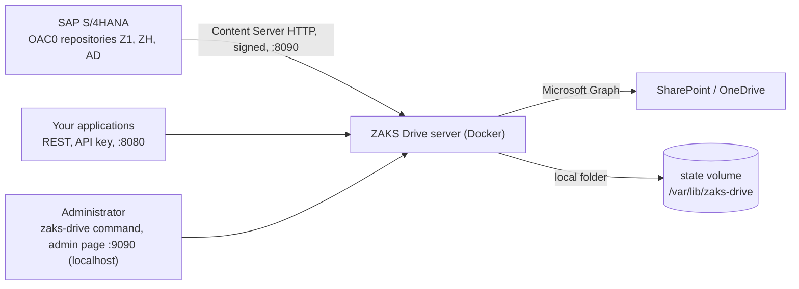

# Setup and usage guide

From an empty Linux server to a working ZAKS Drive, then the everyday jobs, as numbered scenarios. Every scenario says what you need, gives the exact commands, how to **verify** the result and how to **undo** it. Command details are in the [CLI reference](cli-reference.md); the thinking behind it is in the [command guide](cli.md) and the [admin UI guide](ui.md).

> **What has been verified.** The commands in this guide are exercised by the project's tests, and the repository, restart, password and UI flows were run end to end against a Docker container. SAP (OAC0, STRUST, the SAP test reports) and a real Microsoft 365 tenant were verified once by the project owner for DMS originals; see the [README](../README.md#what-is-verified) for what is and is not covered. `<version>` below stands for the release you install, for example `0.1.0-rc.1`.

## Contents

- [How it fits together](#how-it-fits-together)
- [Before you start](#before-you-start)
- [Part 1: Install and first start](#part-1-install-and-first-start)
- [Part 2: Scenarios](#part-2-scenarios)
  - [Scenario 1: Try it in five minutes, no Microsoft 365, no SAP](#scenario-1-try-it-in-five-minutes-no-microsoft-365-no-sap)
  - [Scenario 2: Store documents of an application in SharePoint (REST)](#scenario-2-store-documents-of-an-application-in-sharepoint-rest)
  - [Scenario 3: Connect SAP S/4HANA to SharePoint](#scenario-3-connect-sap-s4hana-to-sharepoint)
  - [Scenario 4: Add a local-folder archive repository (AD)](#scenario-4-add-a-local-folder-archive-repository-ad)
  - [Scenario 5: Add a second SharePoint repository with its own Entra application (ZH)](#scenario-5-add-a-second-sharepoint-repository-with-its-own-entra-application-zh)
  - [Scenario 6: Work in the admin UI](#scenario-6-work-in-the-admin-ui)
  - [Scenario 7: Change a repository safely (apply, drain, fall back)](#scenario-7-change-a-repository-safely-apply-drain-fall-back)
  - [Scenario 8: Day-to-day operation and health](#scenario-8-day-to-day-operation-and-health)
  - [Scenario 9: Update and roll back](#scenario-9-update-and-roll-back)
  - [Scenario 10: Back up and restore](#scenario-10-back-up-and-restore)
  - [Scenario 11: Forgot the admin password](#scenario-11-forgot-the-admin-password)
  - [Scenario 12: Retire a repository: detach, re-add, purge](#scenario-12-retire-a-repository-detach-re-add-purge)
  - [Scenario 13: Reach the admin page from your laptop](#scenario-13-reach-the-admin-page-from-your-laptop)
  - [Scenario 14: Automate it (scripts, CI)](#scenario-14-automate-it-scripts-ci)
  - [Scenario 15: Rotate secrets](#scenario-15-rotate-secrets)
  - [Scenario 16: Something is wrong](#scenario-16-something-is-wrong)
- [Quick reference](#quick-reference)

## How it fits together



- A **repository** is a named place for documents. Its ID is also the SAP content repository ID in OAC0 when you expose it to SAP.
- A repository stores its documents in **SharePoint/OneDrive** (through Microsoft Graph, with the global Entra application or its own) or in a **local folder** of the server. These are the two storage types; **each repository gets exactly one, chosen when it is created, and it cannot be switched later** (documents are not moved between them: to change, add a new repository and copy the documents with the REST API). Several repositories can use different types side by side, and each can be reached by REST applications and, if you expose it, by SAP.
- **Static** repositories are written in `config.yaml` (the first one is created by `setup`). **Managed** repositories are created with `zaks-drive repo` or the admin page; their definitions, secrets and local documents live in the **state volume**.
- Two programs: **`zaks-drive`** runs on the host and manages the deployment; **`zaks-drive-server`** runs in the container and serves traffic.

## Before you start

| Decision or item | Notes |
|---|---|
| A Linux host with Docker Engine and the Compose v2 plugin | amd64 or arm64. The installer never installs Docker and never uses `sudo`. 2 GB RAM is plenty; 1 GB is the container limit |
| Ports | REST `8080`, SAP `8090` (published on the bind address you choose), admin `9090` (**always `127.0.0.1` only**) |
| Microsoft 365 | An Entra application and a SharePoint library, for SharePoint repositories. Not needed to try it ([Scenario 1](#scenario-1-try-it-in-five-minutes-no-microsoft-365-no-sap)) or for local repositories after the first setup |
| Who calls it | **Applications** (REST, API keys) and/or **SAP** (Content Server, signed URLs) |
| Where documents go | SharePoint (Microsoft keeps and backs them up) or a **local folder** (you back up the `state` volume) |
| Time for SAP | SAP Basis support for OAC0 and STRUST, and a test system |

> **You can start with either storage, and Microsoft is optional.** `setup` asks where documents are stored first. **Local folder** needs no Microsoft account, tenant or secret at all (good for trying it out, or for an archive on your own disk). **SharePoint** needs the Entra application. You can add repositories of either kind later, in any order, and each SharePoint repository may use the global application or its **own** tenant, client and secret ([Scenario 5](#scenario-5-add-a-second-sharepoint-repository-with-its-own-entra-application-zh)). The two paths are marked **Path A (local first)** and **Path B (SharePoint first)** below.

## Part 1: Install and first start

### 1. Install the command

```bash
curl -fsSLO https://github.com/Lamiv/zaks-drive/releases/download/v<version>/install.sh
less install.sh                           # read it before you run it
sh install.sh --version <version>         # verifies the download against SHA256SUMS before using it
zaks-drive version                        # the command is installed; no server yet
```

If the command is not found, add `~/.local/bin` to your `PATH` (the installer says where it put it). Add `--verify-attestation` (needs the GitHub CLI) to also verify GitHub's signed build provenance. From source instead: `go build -o zaks-drive ./cmd/zaks-drive`.

### 2. Prepare Microsoft 365 (Path B only; skip this for Path A)

**Path A (local first): nothing to prepare, go to step 3.** Path B, once, by an administrator:

1. [Register the Entra application](microsoft-365/entra-app-registration.md): note the tenant ID and client ID and create a client secret (copy the **Value**, not the Secret ID).
2. [Choose the permission](microsoft-365/graph-permissions.md): `Sites.Selected` plus a site grant with role `write` is recommended.
3. [Create or pick the SharePoint library](microsoft-365/sharepoint-configuration.md) and a folder name for the documents (default `SAP_DMS`).

### 3. Run the setup wizard

```bash
zaks-drive setup
```

**Path A, local first, no Microsoft account.** The first question is *"Where will documents be stored first?"*; press Enter for `local` (the default when nothing Microsoft is known). It then asks only for the directory, address and ports, the SAP interface (default no), TLS and the log level. Or in one line:

```bash
zaks-drive setup --non-interactive --storage local --dir /opt/zaks-drive          # nothing from Microsoft
zaks-drive start                       # "running, but no repository is configured yet": expected, not an error
zaks-drive repo add AD --backend local --yes     # your first repository, a folder on this server; applies by a restart
```

You now have a working server (`zaks-drive repo list` shows `AD  local  serving`); try it with [Scenario 2](#scenario-2-store-documents-of-an-application-in-sharepoint-rest)'s commands using `AD` instead of `DMS`. Add SharePoint later with `zaks-drive repo add ZH --backend sharepoint ...` ([Scenario 5](#scenario-5-add-a-second-sharepoint-repository-with-its-own-entra-application-zh)). To expose a local repository to SAP, enable the interface (`--interfaces rest,contentrepo` at setup, or edit `server.interfaces`) and add it with `--sap` ([Scenario 4](#scenario-4-add-a-local-folder-archive-repository-ad)).

**Path B, SharePoint first.** Answer `sharepoint` to the first question. It asks for the directory (default `/opt/zaks-drive`), bind address and ports, interfaces (`rest`, `contentrepo`), tenant and client IDs, the client secret (typed without echo), the SharePoint site, library and folder, the first SAP repository ID (default `Z1`), allowed networks and TLS. It generates the API keys and the admin token, validates everything with the server's own loader **before** writing, and builds the image from the verified release. Secrets go only into `.env` (mode 600).

Path B non-interactive (scripts, configuration management):

```bash
printf '%s' "$ENTRA_CLIENT_SECRET" > /run/secrets/zd-secret       # a file you manage; never a command-line value
zaks-drive setup --non-interactive --dir /opt/zaks-drive \
  --site-url https://contoso.sharepoint.com/sites/SAP_DOCS --library Documents --root-path SAP_DMS \
  --tenant-id 11111111-2222-3333-4444-555555555555 --client-id 66666666-7777-8888-9999-aaaaaaaaaaaa \
  --client-secret-file /run/secrets/zd-secret \
  --content-repo Z1:required --allowed-network 10.20.0.0/16 --bind 10.20.0.5
```

Check the files without starting anything (contacts neither Microsoft nor SAP):

```bash
zaks-drive config validate --dir /opt/zaks-drive
```

### 4. Start and verify

```bash
zaks-drive start --dir /opt/zaks-drive         # waits until /readyz says ready
zaks-drive status                              # containers, health, version, repositories
zaks-drive check                               # contacts Microsoft: token, permissions, a test file in SharePoint
zaks-drive doctor                              # local diagnostics; WARN items are the to-do list
```

`start` prints the endpoints, including the admin page:

```text
ZAKS Drive is ready.
  REST API            http://<this-host>:8080/api/v1
  SAP Content Server  http://<this-host>:8090/ContentServer/ContentServer.dll
  Health and metrics  http://127.0.0.1:9090  (localhost only)
  Admin page          http://127.0.0.1:9090/admin/ui/  (localhost only; first login: admin / admin, ...)
```

If `check` fails, read its `fix:` line; the usual causes are the Secret ID pasted instead of the Value, missing admin consent, or a missing `Sites.Selected` site grant ([troubleshooting](#scenario-16-something-is-wrong)).

### 5. First login to the admin page: choose your password

Open `http://127.0.0.1:9090/admin/ui/` (on the server itself, or through [an SSH tunnel](#scenario-13-reach-the-admin-page-from-your-laptop)). Log in as **`admin`** with the password **`admin`**. The page immediately asks for a new password and shows nothing else until you set one (at least 12 characters; a few unrelated words make a good passphrase; your password manager can fill it).

> Do this right after the first start. Until then the well-known `admin` / `admin` works from anyone who can reach port 9090 on the server, which is why the port is bound to `127.0.0.1`. `zaks-drive doctor` warns (`admin-password`) while the default is active.

### What you have now

| Thing | Where |
|---|---|
| Deployment | `/opt/zaks-drive/` with `docker-compose.yml`, `.env` (secrets, mode 600), `config.yaml` (no secrets) |
| Path B: static repository `DMS` | SharePoint, from `config.yaml`. (Path A has none yet: you add `AD` with `repo add`) |
| Path B: SAP content repository `Z1` | maps to `DMS`, folder `ContentServer/Z1`, signatures required. (Path A: SAP repositories are created per repository with `repo add ... --sap`) |
| Managed state | the `state` volume at `/var/lib/zaks-drive` (empty until you add repositories) |
| Credentials | REST API keys and `ADMIN_TOKEN` in `.env`; the admin page password you just chose |

## Part 2: Scenarios

### Scenario 1: Try it in five minutes, no Microsoft 365, no SAP

**Goal:** see the REST API and the SAP interface work against the bundled Microsoft Graph emulator. **Needs:** Docker with Compose v2, `git`, `curl`.

```bash
git clone https://github.com/Lamiv/zaks-drive.git && cd zaks-drive
docker compose -f loadtest/docker-compose.yml up -d --build graphmock adapter

KEY=loadtest-key; BASE=http://localhost:8080/api/v1
curl -sS -H "X-API-Key: $KEY" "$BASE/repositories"
echo "hello ZAKS Drive" | curl -sS -X POST -H "X-API-Key: $KEY" --data-binary @- \
  "$BASE/repositories/DMS/documents?folder=demo&fileName=hello.txt"
curl -sS -H "X-API-Key: $KEY" "$BASE/repositories/DMS/children?path=demo"
curl -sS 'http://localhost:8090/ContentServer/ContentServer.dll?serverInfo&pVersion=0047'
```

**Verify:** the upload answer has an `id`; `children` lists `hello.txt`; `serverInfo` lists `Z1` as `running`. **Undo:** `docker compose -f loadtest/docker-compose.yml down -v`. This stack is for trying only: signatures are off and the key is public. More in the [quickstart](quickstart.md).

### Scenario 2: Store documents of an application in SharePoint (REST)

**Goal:** an application uploads, downloads and lists documents through the REST API. **Needs:** [Part 1](#part-1-install-and-first-start) done; an API key from `.env` (`ADAPTER_API_KEY_*`; each key has its own repositories and permissions in `config.yaml`, section `auth.apiKeys`).

```bash
set -a; . /opt/zaks-drive/.env; set +a        # loads the keys into this shell only
BASE=http://localhost:8080/api/v1
KEY=$ADAPTER_API_KEY_S4                        # a key with read and write permission

curl -sS -H "X-API-Key: $KEY" "$BASE/repositories"                        # which repositories this key may use
curl -sS -X POST -H "X-API-Key: $KEY" --data-binary @invoice.pdf \
  "$BASE/repositories/DMS/documents?folder=invoices/2026&fileName=invoice-4711.pdf"
curl -sS -H "X-API-Key: $KEY" "$BASE/repositories/DMS/children?path=invoices/2026"
curl -sS -H "X-API-Key: $KEY" -o back.pdf "$BASE/repositories/DMS/documents/<id>/content"
curl -sS -H "X-API-Key: $KEY" "$BASE/repositories/DMS/search?q=4711"
```

**Verify:** open the SharePoint library; the file is under `SAP_DMS/invoices/2026/`. **Undo:** `DELETE $BASE/repositories/DMS/documents/<id>` (SharePoint's recycle bin keeps it 93 days). Conflict handling (`conflict=rename|replace|fail`), versions, `If-Match`, ranges and paging: [REST API guide](api/rest-api.md). The same calls work on **local** repositories ([Scenario 4](#scenario-4-add-a-local-folder-archive-repository-ad)); only thumbnails and redirect downloads are SharePoint-only.

### Scenario 3: Connect SAP S/4HANA to SharePoint

**Goal:** an SAP content repository (`Z1`) whose documents land in SharePoint. **Needs:** Part 1 done with the `contentrepo` interface and `Z1` (the default), SAP Basis/DMS support, network access from the SAP application servers to port 8090.

1. **Restrict who may call the SAP port** (recommended even with signatures). Edit `/opt/zaks-drive/config.yaml`:

   ```yaml
   contentServer:
     allowedNetworks: ["10.20.0.0/16"]      # the SAP application servers
   ```

   then `zaks-drive restart`.

2. **Create the repository in OAC0** with the same ID: `Z1`, storage type `04`, document area `DMS`, version `0047`, host and port of this server, script `ContentServer/ContentServer.dll`. Run the connection test; it must pass.

3. **Send the certificate** from OAC0 ("Send certificate"). It arrives **inactive**.

4. **Compare and activate.** In the admin page: *SAP certificates*, compare the SHA-256 fingerprint with the system's signing certificate in **STRUST**, then *Activate*. Or on the host:

   ```bash
   cd /opt/zaks-drive
   ZAKS_DRIVE_VERSION=<version> docker compose exec adapter /zaks-drive-server certs list
   ZAKS_DRIVE_VERSION=<version> docker compose exec adapter /zaks-drive-server certs activate Z1 '<authId from the list>'
   ```

5. **Test with SAP's own reports:** `RSCMSTH0`, `RSCMSTH1`, `RSCMSTH2`, `RSCMSTH3` (and `RSCMSTA0`, `RSCMSTAC`). Then store a DMS original (CV01N) and read it back (CV03N): [DMS integration](sap/dms-integration.md).

**Verify:** `zaks-drive doctor` shows `sap-endpoint` and `sap-certificates` as PASS; in SharePoint the document appears under `SAP_DMS/ContentServer/Z1/<shard>/<docId>/`. **Undo:** deactivate the certificate (admin page or `certs deactivate`), remove the repository in OAC0.

Full SAP procedure, signature modes and what SAP sends: [Connect SAP S/4HANA](sap/connect-s4hana-to-sharepoint.md), [OAC0 and certificates](sap/oac0-configuration.md), [SAP troubleshooting](sap/troubleshooting.md). GOS attachments and ArchiveLink use the same commands but are **not yet tested**.

### Scenario 4: Add a local-folder archive repository (AD)

**Goal:** a repository `AD` that keeps documents on the server's disk (for example a cheap SAP archive), exposed to SAP as content repository `AD`. **Needs:** Part 1 done (if you started with Path A and did not enable the SAP interface, set `server.interfaces: [rest, contentrepo]` in `config.yaml` and `zaks-drive restart` first); disk space and a backup plan for the `state` volume.

```bash
zaks-drive repo add AD --backend local --versions 5 --sap --description "Archive" --yes
```

The command shows a summary (no secrets), applies the change by a restart through the maintenance drain, waits until the server is ready again, and prints `Applied. Serving: AD, DMS`. Without `--yes` it asks first. Useful variations: `--path FOLDER` (default: the ID, below the data directory), `--versions N` (0 to 99; 0 keeps no old versions), `--read-only`, `--signature optional`, `--cont-rep A1` (SAP ID other than the repository ID), `--no-restart` (leave it pending).

```bash
zaks-drive repo list                    # AD: local, managed, SAP AD, serving
zaks-drive repo show AD
zaks-drive repo check AD                # write, read, replace (a version is kept), delete, free disk space
```

Use it from an application exactly like Scenario 2, with `/repositories/AD/...`. For SAP, repeat Scenario 3 steps 2 to 5 with repository `AD` (OAC0 repository `AD`, send and activate **its** certificate).

**Verify:** `repo check AD` ends with `All required access is in place`; a test upload appears in `docker run --rm -v <project>_state:/s alpine ls /s/data/AD`. **Undo:** `zaks-drive repo remove AD` detaches it and **keeps the documents** ([Scenario 12](#scenario-12-retire-a-repository-detach-re-add-purge)).

> Local repositories: one server instance owns the folder; there is no replication. Back up the volume ([Scenario 10](#scenario-10-back-up-and-restore)). Search is by file name only, and there are no thumbnails.

### Scenario 5: Add a second SharePoint repository with its own Entra application (ZH)

**Goal:** repository `ZH` in another site, using a **different** Entra application (for example another tenant or a stricter permission). **Needs:** a second app registration with its tenant ID, client ID and secret; its site grant.

```bash
printf '%s' "$ZH_CLIENT_SECRET" > /root/zh-secret && chmod 600 /root/zh-secret      # a file you manage

zaks-drive repo add ZH --backend sharepoint \
  --site-url https://contoso.sharepoint.com/sites/HR --library Documents --root-path SAP_HR \
  --tenant-id 11111111-2222-3333-4444-555555555555 --client-id 66666666-7777-8888-9999-aaaaaaaaaaaa \
  --secret-file /root/zh-secret --sap --yes

shred -u /root/zh-secret                                  # the server keeps its own copy (mode 600)
zaks-drive repo check ZH                                  # signs in with ZH's own application
```

The secret is read from the file (or `--secret-stdin`, or a hidden prompt), travels in the request body or on standard input, and is stored as its own file in the volume. It is **never** accepted as a flag value and never printed. Repositories that share the same application share one token and one Graph client; a throttled tenant does not slow another.

**Verify:** `zaks-drive repo show ZH` says `Application: own: tenant ..., client ...` and `Client secret: set`; `zaks-drive check` lists the application as its own group. **Undo:** `zaks-drive repo update ZH --global-app --yes` returns it to the global application and removes its secret from disk; `repo remove ZH` detaches it.

### Scenario 6: Work in the admin UI

**Goal:** do the repository, certificate and diagnostic jobs in a browser. Open `http://127.0.0.1:9090/admin/ui/` ([tunnel](#scenario-13-reach-the-admin-page-from-your-laptop) if remote) and log in as `admin` ([first login](#5-first-login-to-the-admin-page-choose-your-password)).

| View | Typical use |
|---|---|
| Overview | Is it ready? Which repositories are serving? A banner shows "changes pending" or a red warning if the server fell back to the last working state |
| Repositories | **Add repository** (local or SharePoint, SAP exposure, own application with a write-only secret field), **Edit**, **Test access**, **Detach** |
| SAP certificates | After "Send certificate" in OAC0: compare the fingerprint with STRUST, **Activate** or **Deactivate** |
| Diagnostics | The checks the server can make about itself, each with a fix |
| Logs | The server's recent log lines (credentials masked); filter by level or request ID; copy for a ticket |
| Audit | Who changed what, when |
| Settings | The effective configuration without secrets |
| Account | Change your password |

A change in *Repositories* is **saved** first; the yellow banner offers **Apply and restart**. Applying drains running requests first ([Scenario 7](#scenario-7-change-a-repository-safely-apply-drain-fall-back)); afterwards you log in again (sessions end with a restart). The page never deletes documents; purge exists only in the command ([Scenario 12](#scenario-12-retire-a-repository-detach-re-add-purge)).

### Scenario 7: Change a repository safely (apply, drain, fall back)

**Goal:** change a repository without dropping SAP requests or risking the whole service.

1. Make the change: `zaks-drive repo update AD --versions 10`. The command validates it with the server's own loader **before saving**; an invalid change is rolled back and nothing is written.
2. Read the confirmation text: *"Applying restarts ZAKS Drive: new requests get 503 with Retry-After while running requests finish (SAP retries), then it starts again."*
3. The command calls the server's admin API, which enters **maintenance mode**, waits up to `server.drainTimeout` (default 30 s) for running requests, then exits; Docker's `restart: unless-stopped` starts it again; the command waits until `/readyz` says ready and prints `Applied. Serving: ...`.

If you prefer to batch several changes and restart once:

```bash
zaks-drive repo update AD --versions 10 --yes --no-restart
zaks-drive repo update ZH --root-path SAP_HR2 --yes --no-restart
zaks-drive status          # "Pending: repository changes are waiting for a restart"
zaks-drive restart         # applies both
```

(`restart` stops abruptly; the drained restart is what `repo add|update|remove` use when you do not pass `--no-restart`. The admin page's **Apply and restart** is the drained one.)

**Safety net:** if a change somehow fails to validate at the next start, the server keeps serving the **last working state**, logs the reason, and `status`, `doctor` and the admin page show it. The command reports such a restart as a failure: *"the new settings were NOT applied"*. Fix the definition (`zaks-drive repo show <id>`, `repo update`) and apply again.

**Verify:** `zaks-drive repo list` shows `serving` for every repository and no pending notice. Requests cut by a drain that outlasted its time are logged with their request IDs (`zaks-drive logs --request-id <id>`).

### Scenario 8: Day-to-day operation and health

```bash
zaks-drive status                         # containers, readiness, version, repositories, pending changes
zaks-drive status --json | jq .ready      # machine-readable
zaks-drive logs --tail 200                # sanitized: secrets masked by value and pattern
zaks-drive logs --follow --level warn     # live, warnings and errors only
zaks-drive logs --iface contentrepo --since 1h
zaks-drive logs --request-id <id>         # everything one request did (the id is in error answers)
zaks-drive doctor                         # 22 local checks, each PASS / WARN / FAIL / SKIPPED with the fix
zaks-drive doctor --list                  # what each check does and how
zaks-drive doctor --connectivity          # also contacts Microsoft (same as `zaks-drive check`)
zaks-drive stop ; zaks-drive start        # stop keeps containers and data
```

Metrics for Prometheus are on `http://127.0.0.1:9090/metrics` ([monitoring](operations/monitoring.md)); `/healthz` and `/readyz` are unauthenticated and used by Docker's health check. `/readyz` is ready only when **every** repository is reachable.

**When something needs a person:** collect a bundle (allowlisted, secrets excluded, fails closed if one is found) and attach it to the support request:

```bash
zaks-drive support bundle --output /tmp/zd-support.tar.gz --yes
```

### Scenario 9: Update and roll back

```bash
zaks-drive update --check                 # compares versions; changes nothing
zaks-drive update --version <new> --yes   # downloads, verifies against SHA256SUMS, builds, restarts, waits for ready
zaks-drive rollback --yes                 # back to the previous version (also automatic if the new one does not become ready)
```

A pre-release must be named with `--version`; a move to another compatibility line or a downgrade needs `--allow-breaking`. Your `.env`, `config.yaml` and the **state volume** are kept. Read the CHANGELOG's upgrade notes first.

**Verify:** `zaks-drive version` shows the new version for both the command and the running server; `zaks-drive doctor`.

### Scenario 10: Back up and restore

What to back up:

| What | Why | How |
|---|---|---|
| `/opt/zaks-drive/.env` and `config.yaml` | credentials and settings | a password vault or configuration store (mode 600 for `.env`) |
| The **`state` volume** | managed repository definitions, their secrets, **local documents**, the admin password hash, the audit log | see below |
| SharePoint content | documents of SharePoint repositories | Microsoft 365 backup and the recycle bin |

```bash
zaks-drive stop                                                            # a consistent copy: stop writers first
docker run --rm -v <project>_state:/s -v "$PWD":/b alpine \
  tar czf /b/zd-state-$(date +%F).tar.gz -C /s .
zaks-drive start
```

(`<project>` is the Compose project name, by default the deployment directory's name; `docker volume ls --filter name=state` shows it.) The archive holds secrets: store it encrypted and restrict access.

**Restore** on a rebuilt server: install and `setup` as in Part 1 with the same `.env`, then

```bash
zaks-drive stop
docker run --rm -v <project>_state:/s -v "$PWD":/b alpine sh -c 'cd /s && tar xzf /b/zd-state-<date>.tar.gz && chown -R 65532:65532 .'
zaks-drive start ; zaks-drive repo list ; zaks-drive repo check AD
```

The `chown` matters: the server runs as user `65532`, and secrets must stay mode 600. More: [backup and recovery](operations/backup-recovery.md).

### Scenario 11: Forgot the admin password

The admin page password cannot be recovered, only reset, and only from the Docker host:

```bash
zaks-drive admin reset-password           # asks first; creates NO_ADMIN in the state volume and restarts through the drain
```

Open the admin page: log in as `admin` / `admin`, choose a new password at once. The server deletes `NO_ADMIN` as soon as the new password is set. The `ADMIN_TOKEN` that the command uses is a separate secret and is not touched. By hand: create an empty file named `NO_ADMIN` in the root of the state volume and restart the server. Details and the security reasoning: [command guide](cli.md#admin-ui-password).

### Scenario 12: Retire a repository: detach, re-add, purge

Three different things, deliberately far apart:

| Goal | Command | Documents |
|---|---|---|
| Stop serving a repository for now | `zaks-drive repo remove AD` (SAP-exposed: add `--allow-in-use`) | **kept** |
| Serve it again | `zaks-drive repo add AD ...` with the same settings | served again |
| Destroy the documents of a local repository | `zaks-drive repo purge AD --plan`, then `--execute` | **deleted for good** |

**Before detaching a SAP-exposed repository,** remove it in SAP first (OAC0, KPro storage categories, ArchiveLink): SAP keeps references to the documents and gets errors for them while the repository is not served.

**Purge** is local-only, host-only and refuses to run while the server serves the repository:

```bash
zaks-drive repo remove AD --allow-in-use --yes          # 1. detach and restart without it
zaks-drive repo purge AD --plan                         # 2. counts what would go; prints a challenge phrase (valid 15 minutes)
#   documents  1204 in 87 folders, 3.4 GiB
#   PURGE-AD-<expiry>-<mac>
zaks-drive repo purge AD --execute --i-understand-this-destroys-documents
#   asks you to type the repository ID, then paste the phrase
```

SAP has no purge: purging data that SAP still references breaks those references and can make other integrations unstable; you take full responsibility, and ZAKS Drive cannot restore anything. A purge is refused if the folder changed after the plan, the phrase expired, the ID is mistyped, or the repository is still defined. SharePoint content is never deleted by ZAKS Drive: remove that folder in SharePoint (its recycle bin gives a recovery window). Both the plan and the purge are written to `audit.log`.

### Scenario 13: Reach the admin page from your laptop

The admin port is published on the server's `127.0.0.1` only, on purpose (it also serves metrics and certificate endpoints). Use an SSH tunnel:

```bash
ssh -L 9090:127.0.0.1:9090 admin@zaks-host        # then browse http://127.0.0.1:9090/admin/ui/ on your laptop
```

Prefer a different local port if 9090 is taken (`-L 19090:127.0.0.1:9090`). If your organisation requires a web address, put a **TLS-terminating reverse proxy that you operate** in front of it, restrict it to administrators, and keep the admin port itself on loopback. Do not set `BIND_ADDRESS` or a port mapping that publishes 9090 on a public interface. To switch the page off: `server.adminUI: false` in `config.yaml`, then `zaks-drive restart` (the command and its Bearer token keep working).

### Scenario 14: Automate it (scripts, CI)

Everything has a non-interactive form, stable exit codes and, where it matters, JSON:

```bash
zaks-drive setup --non-interactive ... --client-secret-file /run/secrets/zd-secret
zaks-drive repo add AD --backend local --sap --yes
zaks-drive repo list --json | jq '.repositories[] | {id, backend, source}'
zaks-drive status --json | jq -e .ready >/dev/null || exit 1
zaks-drive doctor --json --strict                 # exit 1 on warnings too
```

| Exit code | Meaning | Typical reaction |
|---|---|---|
| 0 | success | continue |
| 1 | a check or operation failed | read stderr; the message has a `fix:` line |
| 2 | bad command line | fix the call |
| 3 | Docker missing or unusable | install or fix Docker |
| 4 | no deployment found | pass `--dir` |
| 5 | started but not ready | `zaks-drive logs`, `doctor` |
| 6 | a download failed verification | do **not** retry blindly; investigate |
| 7 | declined (no `--yes`, no terminal) | add `--yes` when intended |

Without a terminal the command never proceeds on its own: a confirmation without `--yes` answers "no" with exit 7. Secrets for automation come from files or standard input (`--client-secret-file`, `--secret-file`, `--secret-stdin`), never from arguments. The admin API itself (Bearer `ADMIN_TOKEN`, JSON, coded errors) is documented in the [admin UI guide](ui.md#the-admin-api).

### Scenario 15: Rotate secrets

| Secret | Where | Steps |
|---|---|---|
| Global Entra client secret | `.env` (`GRAPH_CLIENT_SECRET`) | Create a new secret in Entra, edit `.env`, `zaks-drive restart`, `zaks-drive check`, delete the old secret in Entra |
| A repository's own client secret | state volume | `zaks-drive repo update ZH --secret-file ./new-secret --yes` (applies by restart), `repo check ZH`, delete the old secret in Entra |
| REST API keys, `ADMIN_TOKEN` | `.env` | Replace the value, `zaks-drive restart`, update the callers; keys are compared in constant time and only their hashes are needed (`sha256` form is supported in `config.yaml`) |
| Admin page password | state volume | Admin page, *Account*, or [reset](#scenario-11-forgot-the-admin-password) |
| SAP certificate | SharePoint (`~certs`) | After SAP renews its PSE: "Send certificate" again and activate the new one ([Scenario 3](#scenario-3-connect-sap-s4hana-to-sharepoint)) |

A secret that was exposed (pasted into chat, committed, e-mailed) must be treated as compromised: **create a new one, replace it, delete the old one**. More: [security](operations/security.md#secret-management).

### Scenario 16: Something is wrong

Start with `zaks-drive doctor`: it names the failing check and the fix. Then:

| Symptom | First step |
|---|---|
| `start` says not ready | `zaks-drive status` shows the reason; `zaks-drive logs --tail 50 --level warn` |
| `check` fails at the token | wrong tenant or client ID, or the **Secret ID** pasted instead of the **Value**, or an expired secret ([`TOKEN_FAILED`](error-codes.md#token_failed)) |
| `check` passes the token but fails on the site | `Sites.Selected` without a site grant, or admin consent missing ([`SP_ACCESS_DENIED`](error-codes.md#sp_access_denied)) |
| `repo add` says the settings were rejected | nothing was changed; the message names each problem with a code ([error codes](error-codes.md)) |
| After a change the page shows a red banner | the server runs the last working state; `zaks-drive repo list` shows the problem, fix it, apply again |
| `/readyz` is not ready with several repositories | one repository is unreachable: `zaks-drive repo check <id>` for each; the Diagnostics view lists them |
| SAP: connection test works, commands fail with 401 | the certificate is missing or inactive: [`CS_CERT_INACTIVE`](error-codes.md#cs_cert_inactive); activate it ([Scenario 3](#scenario-3-connect-sap-s4hana-to-sharepoint)) |
| SAP: 401 on every request, "URL expired" | clock difference between SAP and the server: fix NTP |
| Locked out of the admin page | [Scenario 11](#scenario-11-forgot-the-admin-password); after 10 wrong passwords it waits (1 minute, doubling) |
| A local repository is full or slow | `zaks-drive repo check <id>` shows free space; check `docker system df` and the volume's disk |
| You cannot tell | `zaks-drive support bundle`, then open an issue ([SUPPORT](../.github/SUPPORT.md)); never post `.env`, secrets or tokens |

Every refused request logs its code and the `X-ErrorCode` header SAP or your application receives; the [error catalogue](error-codes.md) lists each code with cause and fix.

## Quick reference

```bash
# install and set up
sh install.sh --version <version>      zaks-drive setup      zaks-drive config validate
zaks-drive start | stop | restart | status | logs | doctor | check | version
# repositories
zaks-drive repo list | show <id> | add <id> ... | update <id> ... | remove <id> | check <id>
zaks-drive repo purge <id> --plan   (then --execute ...)         # local, detached only
# admin page
zaks-drive admin reset-password
# lifecycle
zaks-drive update --check | --version <v> | rollback | support bundle
```

Every flag of every command: [CLI reference](cli-reference.md). Ports and files: [command guide](cli.md#reference). Settings: [configuration](configuration.md).
